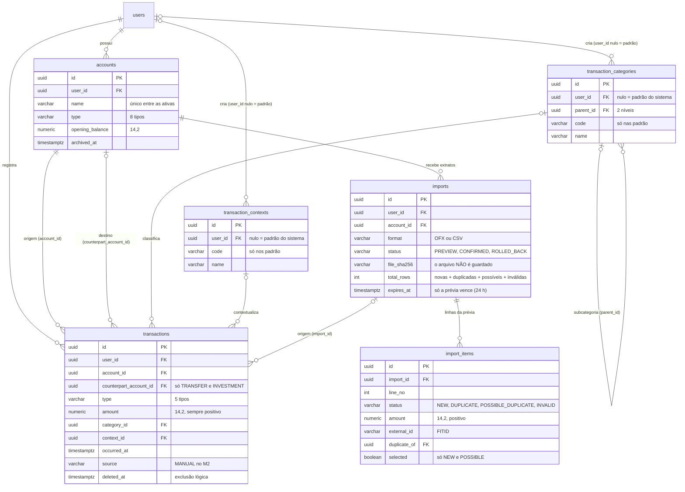

# Modelo de dados e API (Milestones 2, 3 e 4)

Fonte da verdade: as migrações em `apps/backend/src/main/resources/db/migration` (V1–V6). Este documento é o mapa; em caso de divergência, vale a migração. Decisões em [ADR-013](../02_Arquitetura/Arquitetura/ADR/013-saldo-derivado-e-classes-de-liquidez.md) e [ADR-014](../02_Arquitetura/Arquitetura/ADR/014-categorias-em-dois-niveis-e-contextos.md).

## Diagrama

`transactions` ganha `import_id` e `external_id` (V6, M3). Decisões em [ADR-015](../02_Arquitetura/Arquitetura/ADR/015-importacao-em-duas-fases-sem-guardar-o-arquivo.md) e [ADR-016](../02_Arquitetura/Arquitetura/ADR/016-deduplicacao-em-camadas-com-contagem-de-ocorrencias.md).

## Regras que o banco impõe (além da API)

| Regra | Como |
|---|---|
| Valor sempre positivo, moeda BRL, tipos e origem válidos | `CHECK` em `accounts` e `transactions` |
| Conta e destino são do **mesmo usuário** da transação | chave estrangeira composta `(conta, user_id)` → `accounts (id, user_id)` |
| Só TRANSFER e INVESTMENT têm destino, e ele difere da origem | `CHECK ck_transactions_counterpart` |
| Categoria e contexto são padrão ou do mesmo dono | gatilho `check_transaction_refs` |
| Categorias em no máximo 2 níveis, pai padrão ou do mesmo dono | gatilho `check_category_hierarchy` |
| Nome único entre as contas ativas; único por pai nas categorias | índices únicos parciais/por escopo |
| Apagar o usuário apaga tudo dele (LGPD), menos os padrões | `ON DELETE CASCADE` a partir de `users` |
| A importação é da conta e do dono; a transação importada só aponta para importação **da própria conta** | FK composta `(conta, user_id)` em `imports` e `(import_id, account_id)` em `transactions` |
| Contadores da importação somam o total; datas seguem o status | `CHECK ck_imports_counts` e `ck_imports_lifecycle` |
| Só NOVA e POSSÍVEL duplicata podem ser importadas; linha válida tem data, tipo e valor positivo | `CHECK` em `import_items` |
| O identificador externo não se repete na conta entre as transações ativas (o rollback o libera) | índice único parcial `uk_transactions_external` |
| Importação confirmada não pode ser apagada, só desfeita | FK de `transactions.import_id` (sem `CASCADE`) |
| Estado de classificação coerente: NONE sem origem; AUTO e SUGGESTED com origem e confiança e nunca do usuário; CONFIRMED do usuário; confiança entre 0 e 1 | `CHECK ck_transactions_class_shape` e relacionados (V7) |
| A sugestão só existe em SUGGESTED e nunca cobre categoria ou contexto já preenchido | `CHECK ck_transactions_suggestion`; gatilho `check_transaction_suggestion_refs` para o dono |
| Favorecido único por usuário e por nome normalizado; categorias e contextos de favorecidos, votos, regras e feedback são padrão ou do mesmo dono | `uk_pix_recipients_name` e gatilhos `check_recipient_*`, `check_feedback_refs`, `check_transaction_refs` |
| Regra tem ao menos um alvo (categoria ou contexto), comparação CONTÉM/COMEÇA/IGUAL e condição única por usuário | `CHECK` e `uk_rules_condition` |
| Feedback só referencia transação do mesmo usuário e acompanha a exclusão dela | FK composta `(transaction_id, user_id)` com `ON DELETE CASCADE` |

O `NUMERIC(14,2)` do Postgres **arredonda em silêncio** valores com mais de 2 casas; por isso a API recusa (422) antes de gravar.

### Classificação (M4, V7)

`transactions` ganha `classification_status` (`NONE`, `AUTO`, `SUGGESTED`, `CONFIRMED`), `classification_source`, `classification_confidence` e `suggested_category_id`/`suggested_context_id`. Novas tabelas: `pix_recipients` (favorecido por usuário, com `pinned_category_id`/`pinned_context_id` quando o usuário fixa a escolha), `pix_recipient_category_votes` e `pix_recipient_context_votes` (a confiança é **calculada** dos votos, não guardada), `categorization_rules` e `classification_feedback`. Decisões em [ADR-017](../02_Arquitetura/Arquitetura/ADR/017-classificacao-em-estagios-com-confianca-calibrada.md) e [ADR-018](../02_Arquitetura/Arquitetura/ADR/018-privacidade-de-favorecidos-e-feedback.md).

## Liquidez (o que entra em cada total)

| Tipo de conta | Total |
|---|---|
| CHECKING_ACCOUNT, SAVINGS_ACCOUNT, CASH | `availableCash` |
| VA, VR | `restrictedBalance` (nunca é caixa disponível) |
| INVESTMENT_ACCOUNT | `investedAssets` |
| CREDIT_CARD | `creditCardBalance` (dívida, negativo) |
| OTHER | `otherBalance` |

`totalNetWorth` é a soma de todos. O saldo de uma conta é `opening_balance` + efeito das transações (INCOME e REFUND somam; EXPENSE subtrai; TRANSFER e INVESTMENT subtraem da origem e somam no destino). Só contas ativas entram nos totais.

## Endpoints (`/api/v1`)

Todos exigem `Authorization: Bearer`, exceto login, refresh, logout, `system/info` e `openapi`. A documentação interativa (OpenAPI) está em `/api/v1/openapi`. Dinheiro sai e entra como string decimal (`"1234.50"`). Recurso de outro usuário responde 404, igual a inexistente.

| Área | Rotas | Papéis |
|---|---|---|
| Autenticação | `POST /auth/login`, `/auth/refresh`, `/auth/logout` | público |
| Perfil | `GET`, `PATCH /users/me` | qualquer autenticado |
| Administração | `GET`, `POST /admin/users` (cria só USER) | ADMIN |
| Contas | `POST`, `GET`, `GET /{id}`, `PATCH /{id}` em `/accounts` | USER, ADMIN |
| Categorias | `GET` (árvore), `POST`, `PATCH /{id}` em `/categories` | USER, ADMIN |
| Contextos | `GET`, `POST`, `PATCH /{id}` em `/contexts` | USER, ADMIN |
| Transações | `POST`, `GET` (filtros e paginação), `GET /{id}`, `PATCH /{id}`, `DELETE /{id}` em `/transactions` | USER, ADMIN |
| Resumo | `GET /summary`, `GET /summary/monthly?month=AAAA-MM` | USER, ADMIN |
| Importações | `POST /imports` (multipart: prévia), `POST /imports/suggest-mapping`, `GET /imports`, `GET /imports/{id}`, `GET /imports/{id}/items`, `POST /imports/{id}/confirm`, `POST /imports/{id}/rollback`, `DELETE /imports/{id}` (descartar prévia) | USER, ADMIN |

Erros seguem ProblemDetail (RFC 7807): 400 validação, 401 sem sessão, 403 sem permissão ou padrão do sistema, 404 inexistente ou de outro usuário, 409 conflito (nome duplicado, conta arquivada, importação já confirmada), 410 prévia vencida, 413 arquivo grande demais, 422 regra de negócio (valor com mais de 2 casas, data no futuro, tipo e contas inalteráveis, extrato ilegível), 429 limite de prévias por hora.
