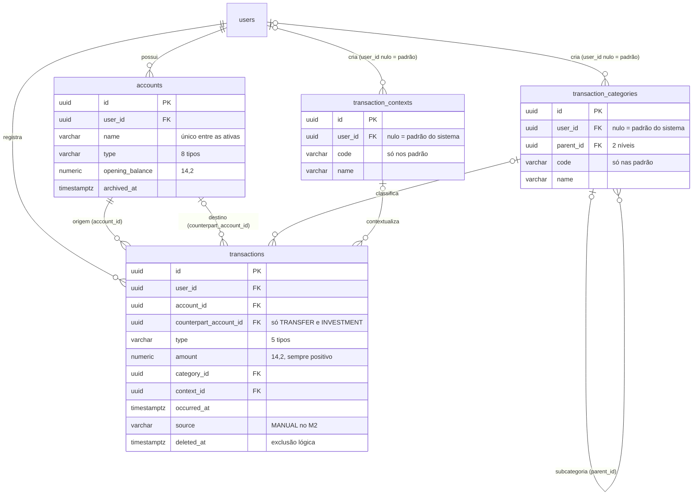

# Modelo de dados e API (Milestone 2)

Fonte da verdade: as migrações em `apps/backend/src/main/resources/db/migration` (V1–V5). Este documento é o mapa; em caso de divergência, vale a migração. Decisões em [ADR-013](../02_Arquitetura/Arquitetura/ADR/013-saldo-derivado-e-classes-de-liquidez.md) e [ADR-014](../02_Arquitetura/Arquitetura/ADR/014-categorias-em-dois-niveis-e-contextos.md).

## Diagrama

## Regras que o banco impõe (além da API)

| Regra | Como |
|---|---|
| Valor sempre positivo, moeda BRL, tipos e origem válidos | `CHECK` em `accounts` e `transactions` |
| Conta e destino são do **mesmo usuário** da transação | chave estrangeira composta `(conta, user_id)` → `accounts (id, user_id)` |
| Só TRANSFER e INVESTMENT têm destino, e ele difere da origem | `CHECK ck_transactions_counterpart` |
| Categoria e contexto são padrão ou do mesmo dono | gatilho `check_transaction_refs` |
| Categorias em no máximo 2 níveis, pai padrão ou do mesmo dono | gatilho `check_category_hierarchy` |
| Nome único entre as contas ativas; único por pai nas categorias | índices únicos parciais/por escopo |
| Apagar o usuário apaga tudo dele (LGPD), menos os padrões | `ON DELETE CASCADE` a partir de `users` |

O `NUMERIC(14,2)` do Postgres **arredonda em silêncio** valores com mais de 2 casas; por isso a API recusa (422) antes de gravar.

## Liquidez (o que entra em cada total)

| Tipo de conta | Total |
|---|---|
| CHECKING_ACCOUNT, SAVINGS_ACCOUNT, CASH | `availableCash` |
| VA, VR | `restrictedBalance` (nunca é caixa disponível) |
| INVESTMENT_ACCOUNT | `investedAssets` |
| CREDIT_CARD | `creditCardBalance` (dívida, negativo) |
| OTHER | `otherBalance` |

`totalNetWorth` é a soma de todos. O saldo de uma conta é `opening_balance` + efeito das transações (INCOME e REFUND somam; EXPENSE subtrai; TRANSFER e INVESTMENT subtraem da origem e somam no destino). Só contas ativas entram nos totais.

## Endpoints (`/api/v1`)

Todos exigem `Authorization: Bearer`, exceto login, refresh, logout, `system/info` e `openapi`. A documentação interativa (OpenAPI) está em `/api/v1/openapi`. Dinheiro sai e entra como string decimal (`"1234.50"`). Recurso de outro usuário responde 404, igual a inexistente.

| Área | Rotas | Papéis |
|---|---|---|
| Autenticação | `POST /auth/login`, `/auth/refresh`, `/auth/logout` | público |
| Perfil | `GET`, `PATCH /users/me` | qualquer autenticado |
| Administração | `GET`, `POST /admin/users` (cria só USER) | ADMIN |
| Contas | `POST`, `GET`, `GET /{id}`, `PATCH /{id}` em `/accounts` | USER, ADMIN |
| Categorias | `GET` (árvore), `POST`, `PATCH /{id}` em `/categories` | USER, ADMIN |
| Contextos | `GET`, `POST`, `PATCH /{id}` em `/contexts` | USER, ADMIN |
| Transações | `POST`, `GET` (filtros e paginação), `GET /{id}`, `PATCH /{id}`, `DELETE /{id}` em `/transactions` | USER, ADMIN |
| Resumo | `GET /summary`, `GET /summary/monthly?month=AAAA-MM` | USER, ADMIN |

Erros seguem ProblemDetail (RFC 7807): 400 validação, 401 sem sessão, 403 sem permissão ou padrão do sistema, 404 inexistente ou de outro usuário, 409 conflito (nome duplicado, conta arquivada), 422 regra de negócio (valor com mais de 2 casas, data no futuro, tipo e contas inalteráveis).
